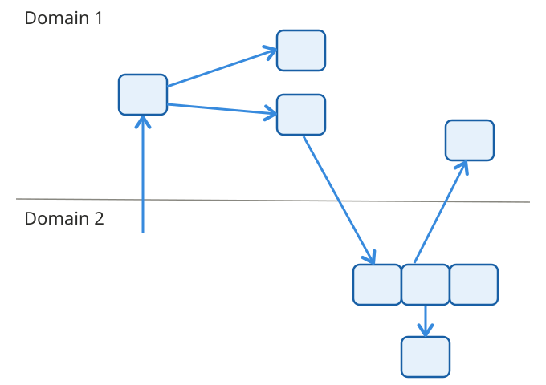
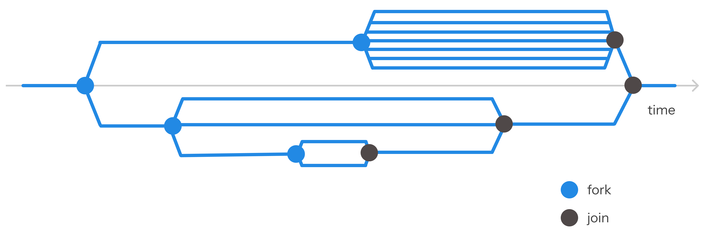

# Intro

15:00 to 18:10, 3:10 hours

- Intro ~10 min
- Motivation and the contention mode ~20 min
  - Exercises ~20 min
- Portability ~20 min
- Fork-join scheduler ~10 min
  - Exercises ~30 min
- **Break ~10 min**, back at 17:00
- Capsules ~30 min
  - Exercises ~30 min
- Exit survey ~10 min

---

{pause up}
### Introductions

{pause}

Introducing us

{pause}

Introducing you
- goals
- OCaml experience
- || programming experience

---

{pause up}
### OxCaml
- Developed by Jane Street with many partners
{pause}
- Released in July 2025, see oxcaml.org
{pause}
- Backwards compatible with OCaml
{pause}
- Preview APIs, no guarantees
{pause}
- Mostly **modes**, mostly for performance and correctness
{pause}
- Some things are upstreamed into OCaml, others will never be

{pause up}
# Contention and portability

{pause}

OCaml 5 introduced multidomain computing

{pause}

Domain = thread

{pause}

Multithreading is hard

{pause}

**Data races**

Recipe
- **Two domains**
- access **mutable data**
- **without synchronization**
- and one of these accesses is a **write**

{pause}

OxCaml **contention** and **portability** mode axes 
prevent data races in **compile time**, part of type checking.

{pause}

**Building blocks** of multidomain computing in OxCaml:

- Mode axes: **contention**, **portability**
- Synchronization primitives: **atomics**
- Code structuring primitives: **capsules**
- More synchonization primitives: **capsules** with a **mutex**
- Domain management framework (a scheduler): **fork-join pool**

---

{pause up}
### Modes

{pause}

- A type decides what a value is
- A mode decides how you can use a value of a type

{pause}

```ocaml
val foo : int * int ref @ mode -> unit
```

{pause}

```ocaml
let foo (p @ mode) = ...
```

{pause}

```ocaml
let p = (5, ref 42)
foo p
```

---

{pause up}

### Domain spawning mechanism

{pause}

To spawn a domain, you pass a function without any parameters (a _nullary_ function)

{pause}

(sometimes also called a _thunk_)

{pause}

```ocaml
val spawn : (unit -> 'a) -> 'a t
```

```ocaml
let d = Domain.spawn (fun () -> 
  5 + 8 (* domain 2's computation *)
) in
40 + 2 in (* domain 1's computations continue here *)
let result = Domain.join d
```

{pause}

If your function needs any parameters, it must **capture** them

{pause}

{#domain-example}
```ocaml
let x = 5 in
let y = 8 in
let f x y = x + y in
let d = Domain.spawn (fun () ->  (* This nullary function *)
  f x y                          (* captures f, x, y *)
) in
let result = Domain.join d
```

{pause up=domain-example}
{#capture-analysis}
Where can a data race occur?

{pause}

_Assume for simplicity the nullary function doesn't spawn any inner domains_

{pause}

**If there is no captured values**
- Memory allocated outside of the nullary function is unreachable
- Memory allocated inside the nullary function is only reachable by its domain

{pause}

$\implies$ no shared memory $\implies$ data races not possible

{pause}

**If some values are captured**
- Captured **data**
- Captured **functions**
- Captured **references** to other memory locations which contain other data, functions, references (its transitive closure is a **reachability graph**)

{pause up=capture-analysis}

$\implies$ both domains can access all of it freely in **runtime** (and cause a data race)

{pause}

$\implies$ all the reachability graph must be safe for multiple domain access, provably in **compile time**

{pause}

Yet the reachability graph is updated dynamically, in **runtime**.

{pause}

$\implies$ divide all values into 'safe' and 'unsafe' in compile time, only allow 'safe' values in the reachability graph (that's modes!)

---

{pause up}
## Memory reachability graph


{pause}

Each cell contains a combination of **data**, **functions**, **references**

---

{pause up}
### Anatomy of a value

A value contains **data** and **functions**

{pause}

```ocaml
let p = (ref 42, (fun x -> x + 1))
```

Where a data race occurs

{pause}

* mutable non-protected data

{pause}

* functions capturing _mutable non-protected data_

{pause}

* functions capturing _function capturing mutable non-protected data_

* etc.

---

{pause up}
### Contention mode axis

Relates to **data**, decides if you can read and write

{pause}

#### Data has immutable and mutable parts

{pause}

### Crosses contention
Immutable data

{pause}

#### Mutable data has synchronized or not synchronized parts

{pause}

### `@ contended` $\implies$ safe to access from multiple domains
Full access to **synchronized mutable data** (atomic, mutex)

No access to any other mutable data parts of the value (temporary hidden, compiler won't allow access)

[//]: # (### `@ shared` $\implies$ safe to READ from multiple domains)
[//]: # (Full **read** access to mutable data protected by a synchronization primitive)
[//]: # (allowing to read &#40;reader-writer lock&#41; &#40;2&#41;)
[//]: # ()
[//]: # (Includes &#40;1&#41;)

{pause}

### `@ uncontended` $\implies$ safe to access from a single domain
Full access to **any mutable data**
 
Includes **synchronized mutable data** (atomic, mutex)

[//]: # (**Rule**: at most one domain can consired a value as `@ uncontended`)

{pause}

**NB**: both modes allow read access for immutable data

{pause up}
```ocaml
val foo : int * int ref @ mode -> ...
let foo (p @ mode) = ...
```

{pause}

{#contention-examples}
### A contended pair

```ocaml
let p = (5, ref 42)
let foo (p @ contended) = ...
foo p
```

{pause}

- **read** `fst p` ✅
- **write** `fst p` -
- **read** `snd p` ❌
- **write** `snd p` ❌

{pause}

Any domain can access `p`, but it can only invoke `fst p`

{pause up=contention-examples}

{#contended-pair-atomic}
### A contended pair with an atomic

```ocaml
let p = (5, ref (Atomic.make 42))
let foo (p @ contended) = ...
foo p
```

{pause}

- **read** `fst p` ✅
- **write** `fst p` -
- **read** `snd p` ✅
- **write** `snd p` ✅

{pause}

Any domain can access `p` fully

{pause up=contended-pair-atomic}
### An uncontended pair

```ocaml
let p @ uncontended = (5, ref 42)
let foo (p @ uncontended) = ...
foo p
```

{pause}

|           | domain 1 | domain 2 |
|-----------|:--------:|:--------:|
| **read**  |    ✅    |    ❌    |
| **write** |    ✅    |    ❌    |

---

{pause up}
## Typechecker

```ocaml
let foo (p @ uncontended) = ...
foo p
```

Checks
- the argument can be passed in the required mode
- the function does not violate access restrictions for the mode

---

{pause up}
## Modes are deep

{pause}

A value is `@ mode` $\implies$ all its fields are `@ mode`, recursively

{pause}

```ocaml
val foo : int ref * int ref @ contended -> unit
(* => both int ref are contended *)
```

{pause}

To construct a value `@ mode`, all its parts must be `@ mode` (or compatible with `@ mode`)

{pause}

```ocaml
val modify : int ref * int ref @ uncontended -> unit

let bar (r1 @ uncontended) (r2 @ contended) = 
    modify (r1, r2) (* ❌ *)
```

---

{pause up}
## Submoding

{pause}

$\le$ means "can be used in place of"

`@ uncontended` $\le$ `@ contended`

{pause}

`@ uncontended` can be passed into a function expecting `@ contended`

```ocaml
let foo (p @ contended) = ...

let bar (p @ uncontended) = foo p (* ✅ *)
```

{pause}

Why?

A function taking a `@ contended` parameter is more restricted

A function taking a `@ contended` parameter is restricted access to everything but synchronized mutable data

A function taking a `@ uncontended` parameter is not restricted: it can access all its parameter's parts, including synchronized mutable data

[//]: # (Reminder: immutable data can be read in any mode because it crosses contention)

[//]: # (Using a value in a certain restrictive mode is like taking a restrictive view on the value: all the parts are still there, but you can only use some of them)


---
{pause up}
## Contention exercises

Letter A

0. Stock
1. Accessing captured values
2. Applier

---
{pause up}
# Portability mode axis

Applies to **functions**, and **values containing functions**

{pause}

## How functions can cause a data race?

A function can **capture** and modify mutable data

{pause}

A function can capture _a reference to another function_ which captures and modifies mutable data

{pause}

{#portable}
## `@ portable` $\implies$ safe to invoke from multiple domains

- captures no data
- captures immutable data
- captures mutable data but never accesses it
- captures mutable data protected by a read-write synchronization primitive 

{pause}

And all functions it captures are also safe to invoke from multiple domains

{pause}

A **function** is `@ portable` if all its **captured** values are `@ contended` or `@ portable`

{pause}

A **value** is `@ portable` if all its components which are function are `@ portable`

{pause}

```ocaml
let incr (x @ uncontended) = x := !x + 1 (* @ portable function *)
let incr_list = [incr; incr; incr]  (* @ portable value *)
```

{pause up=portable}

## `@ nonportable` $\implies$ can only invoke from one domain

{pause}

A function is `@ nonportable` if it captures an `@ uncontended` or `@ nonportable` value

{pause}

```ocaml
let x = ref 0
let incr2 () = x := !x + 1  (* @ nonportable function *)
let incr2_list = [incr2; incr2; incr2]  (* @ nonportable value *)
```

{pause}

**Captured** values, not parameters, make a function `@ nonportable`

---

{pause up}
## Submoding

{pause}

`@ portable` $\le$ `@ nonportable`

{pause}

Recall
- A function is `@ portable` if all its captured values are `@ contended` and `@ portable`
- A function is `@ nonportable` if it captures some `@ uncontended` or `@ nonportable`

{pause}

A `@ portable` function can be used in place of `@ nonportable`,

{pause}

since parts of a value accessible in the `@ contended` mode is a subset of parts of a value accessible in the `@ uncontended` mode

{pause}

```ocaml
let triple = (5, ref 42, (Atomic.make 100))
(* in @ contended you can access 5 and Atomic 100 *)
(* in @ uncontended you can access everything *)
```

{pause}

A `@ portable` function can at most modify the synchronized mutable data that it captures

A `@ nonportable` function can modify any data it captures

Hence, any `@ portable` function is `@ nonportable`

{pause}

This was explained from the "what a function can do" perspective

{pause up}
#### "How a function can be used" perspective

`@ portable` $\le$ `@ nonportable`

A `@ portable` function can be used in place of `@ nonportable`

{pause}

`@ portable` is allowing to run a function on multiple domains.
 
{pause}

If a function can run on multiple domains (and not cause a data race), it can also run on a single domain (and not cause a data race).

{pause}

`@ nonportable` guarantees that a function will only be invoked on one domain

{pause}

```ocaml
val create : (unit -> 'a) @ nonportable -> 'a list
let create (f @ nonportable) = [f (); f (); f ()]

let counter = ref 0 in
let next_nonportable () = incr counter; !counter in
create next_nonportable (* => [1; 2; 3] *)

let counter = Atomic.make 0 in
let next_portable () = Atomic.fetch_and_add counter 1 + 1 in
create next_portable (* => [1; 2; 3] *)
```


---

{pause up}
## Spawning a domain

{pause}

- To spawn a domain, you specify a function

{pause}

- This function must be `@ portable`

```ocaml
val spawn : (unit -> 'a) @ portable -> 'a t
```

{pause}

- So all values it captures must be `@ contended` and `@ portable`

{pause}

- Inside, it may invoke `@ nonportable` functions capturing its own local variables

{pause}

- It may spawn new domains, but with `@ portable` functions only

{pause}

```ocaml
let p = (5, ref 42)
let d = Domain.spawn (fun () -> 
  (* the function to run in parallel *)
  ...
  fst p  (* p is captured as contended *)
  ...
  let x = ref 0 in
  ...
  let incr () = x := !x + 1 in (* nonportable *)
  ...
  incr ()
  ...
)
let result = Domain.join d
```

[//]: # (- A typical value flow: a value is created and used as `@ uncontended`, then passed to multiple functions as `@ contended`, and these functions can be invoked on multiple domains. After these domains join, the value can be used as `@ uncontended` again.)

[//]: # (---)

[//]: # ({pause up})

[//]: # (## Backward compatibility)

[//]: # (- OxCaml went from no domains to multidomains with contention and portability &#40;lucky!&#41;)

[//]: # (- Backward compatible with OCaml without domains)

[//]: # (- Default modes: everything is `@ uncontended` and `@ nonportable`)

[//]: # (- Need a new version of the standard library)

[//]: # ()
[//]: # (```ocaml)

[//]: # (stdlib example)

[//]: # (```)

---

{pause up}
## Fork-join framework

{pause}

- `Parallel.fork_join2` runs two functions in parallel and waits for both
{pause}
- A scheduler, run on a pool of threads

{pause}

```ocaml
let add4 (par : Parallel.t) a b c d =
  let #(a_plus_b, c_plus_d) =
    Parallel.fork_join2 par
        (fun _par -> a + b)
        (fun _par -> c + d)
  in
  a_plus_b + c_plus_d

let run par = add4 par 1 10 100 1000

let () =
  let result =
    Parallel_scheduler.with_parallel run
  in
  Printf.printf "result: %d\n" result (* result: 1111 *)
```

---

{pause up}
## Fork-join framework


---

{pause up}
## `fork_join2` type (almost true, simplified)

```ocaml
module Parallel : sig
  type t

  val fork_join2
    :  t
    -> (t -> 'a) @ portable
    -> (t -> 'b) @ portable
    -> #('a * 'b)
end
```

---

{pause up}
## `fork_join2` type (true)

```ocaml
module Parallel : sig
  type t

  val fork_join2
    :  t @ local
    -> (t @ local -> 'a) @ forkable local once shareable
    -> (t @ local -> 'b) @ once shareable
    -> #('a * 'b)
end
```

---

{pause up}
## Shared and shareable

Denotes (potentially) mutable values that cannot be modified

**Data**: `@ uncontended` $\le$ ` @ shared` $\le$ `@ contended` (contention axis)

{pause}

**Functions**: `@ portable` $\le$ `@ shareable` $\le$ `@ nonportable` (portability axis)

- `@ portable` can only capture `@ portable`, `@ contended`
- `@ shareable` can only capture `@ portable`, `@ shareable`, `@ contended`, `@ shared`
- `@ nonportable` can capture anything

**Fork-join**:
```ocaml
module Parallel : sig
  type t

  val fork_join2
    :  t
    -> (t -> 'a) @ shareable
    -> (t -> 'b) @ shareable
    -> #('a * 'b)
end
```

---

{pause up}
## Shared example

Note: `r.contents`, not `!r`

```ocaml
let run (par : Parallel.t) =
  let r = ref 0 in
  r := !r + 1;                      (* r @ uncontended *)
  let #(a, b) =
    Parallel.fork_join2 par
      (fun _par -> r.contents + 10) (* r @ shared: read only *)
      (fun _par -> r.contents + 20)
  in
  r := !r + a + b;                  (* r @ uncontended again *)
  Printf.printf "r = %d\n" !r       (* r = 33 *)

let () = Parallel_scheduler.with_parallel run
```

{pause}

Note: `!r` inside a branch doesn't compile: `(!)` expects `@ uncontended`

---

{pause up}
## Portability exercises

Letter B

0. Simple
1. Portability captured values vs arguments 
2. Custom `fork_join2`
3. Think: can you express a certain pattern?

---

{pause up}
## Patterns you can't express with contention and portability only

{pause}

```ocaml
(* Doesn't compile *)
let run (par : Parallel.t) =
  let r = ref 0 in
  r := !r + 1;                      (* r @ uncontended *)
  let #(a, b) =
    Parallel.fork_join2 par
      (fun _par -> r := !r + 42) (* we want r @ uncontended here *)
      (fun _par -> ())
  in
  r := !r + a + b;                  (* r @ uncontended again *)
  Printf.printf "r = %d\n" !r       (* r = 33 *)

let () = Parallel_scheduler.with_parallel run
```


---

{pause up}
## Capsules

[Illustration](https://youtu.be/kuoT6CrSY70?si=8421Hf15u1fJe2eF&t=830)

---

{pause up}
## Capsules: create and pass around

{pause}

```ocaml
let capsule_ref = Capsule.Data.create (fun () -> ref 0)
> val capsule_ref : (int ref, 'k) Capsule.Data.t
```

`'k` is a capsule _brand_ (unique identifier)

{pause}

`'k` is an existential type: the compiler knows it but won't tell us

{pause}

`Capsule.Data.t` crosses `contention` and `portability`

{pause}

We can **share** across fork-join freely now, but other mechnisms control that you can **open** it.

---

{pause up}
## Capsules: access, password, key

{pause}

- **key** gives a password
- **password** gives an access
- **access** opens the capsule

{pause}

```ocaml
let (P key) = Capsule.Prim.create () in
let data = Capsule.Data.create (fun () -> ref 1) in
let #(raw_data, _key') =
  Capsule.Prim.Key.with_password key ~f:(fun password ->
    Capsule.Prim.access ~password ~f:(fun access ->
      !(Capsule.Data.unwrap ~access data))) in
...
```

{pause}

Each mechanism protects at its own level

---
{pause up}
## Capsules: access, _, _

{pause}

Access is `@ uncontended`, but `fork_join2` expects a `@ portable` (or at least `@ shareable`) function

{pause}

```ocaml
let increment ~(access : 'k Capsule.Access.t) capsule_ref =
  let ref = Capsule.Data.unwrap ~access capsule_ref in
  ref := !ref + 1
;;
```

{pause}

```ocaml
let parallel_increment parallel ~(access : 'k Capsule.Access.t) =
  let capsule_ref = Capsule.Data.create (fun () -> ref 0) in
  Parallel.fork_join2 parallel
    (fun _ -> increment ~access capsule_ref)
(*                       ^^^^^^                            *)
(* This value is contended but expected to be uncontended. *)
    (fun _ -> increment ~access capsule_ref)
;;
```

---

{pause up}
## Capsules: _, password, _

{pause}

Password is `@ local`, but `fork_join2` expects a `@ global` function

{pause}

```ocaml
let increment ~(password : 'k Capsule.Password.t @ local) capsule_ref =
  Capsule.Prim.access ~password (fun access ->
    let ref = Capsule.Data.unwrap ~access capsule_ref in
    ref := !ref + 1)
  [@nontail]
;;
```

{pause}

```ocaml
let parallel_increment parallel
      ~(password : 'k Capsule.Password.t @ local) =
  let capsule_ref = Capsule.Data.create (fun () -> ref 0) in
  Parallel.fork_join2 parallel
    (fun _ -> increment ~password capsule_ref)
(*                       ^^^^^^^^                          *)
(* The value password is local, so cannot be used inside a *)
(* function that might escape.                             *)
    (fun _ -> increment ~password capsule_ref)
  [@nontail]
;;
```

---

{pause up}
## Capsules: _, _, key

{pause}

Key is `@ unique`, so can only be passed to one branch of `fork_join2` (ownership)

{pause}

```ocaml
let parallel_keys parallel =
  let (P key) = Capsule.create () in
  let fresh_ref = Capsule.Data.create (fun () -> ref 0) in
  let _ = Parallel.fork_join2 parallel
    (fun _ -> Capsule.Prim.Key.with_password key ~f:(fun _ -> ()))
    (fun _ -> Capsule.Prim.Key.with_password key ~f:(fun _ -> ()))
(*                                           ^^^           *)
(* This value is used here, but it is already being used   *)
(* as unique.                                              *)
  in ()
;;
```

---

{pause up}
## Capsules: access, password, key summary

{pause}

| Type            | Represents                               | Provides                | Safety Axis |
|-----------------|------------------------------------------|-------------------------|-------------|
| `'k Access.t`   | Proof that `'k` is the current capsule.  | Access to data in `'k`. | Contention  |
| `'k Password.t` | Permission to enter capsule `'k`.        | `'k Access.t`           | Locality    |
| `'k Key.t`      | The capsule `'k` itself.                 | `'k Password.t`         | Uniqueness  |

---

{pause up}
## Capsules: mutexes

{pause}

```ocaml
let parallel_mutexes parallel =
  let (P key) = Capsule.create () in
  let mutex = Capsule.Mutex.create key in
  let capsule_ref = Capsule.Data.create (fun () -> ref 0) in
    Parallel.fork_join2 parallel
    (fun _ ->
      Capsule.Mutex.with_lock mutex
        ~f:(fun password -> increment ~password capsule_ref))
    (fun _ ->
      Capsule.Mutex.with_lock mutex
        ~f:(fun password -> increment ~password capsule_ref))
;;
```

---
{pause up}
## Capsules: exercises

Letter C

0. Move ownership with capsules
1. Counter read-write
2. Bank
3. Password manipulation

---

{pause up}
## Summary

{pause}

Compile time

{pause}

(The compiler will infer many annotations itself)

{pause}

A value contains parts which are **data** and which are **functions**

{pause}

**Data**: `@ uncontended` $\le$ `@ shared` $\le$ `@ contended` (contention axis)

{pause}

**Functions**: `@ portable` $\le$ `@ shareable` $\le$ `@ nonportable` (portability axis)

{pause}

Submoding: $\le$ means "can be used in place of"

{pause}

Deepness

{pause}

Atomics

{pause}

Capsules (access, password, key; mutex)

{pause}

Other mode axes: locality (`@ local`, `@ global`), uniqueness (`@ unique`, `@ aliased`), linearity (`@ many`, `@ once`)

{pause}

Fork-join framework for spawning domains


---
{pause up}
## Exit survey

---
{pause up}
## Next

- Didn't cover: parallel sequences, parallel arrrays [(official tutorial)](https://oxcaml.org/documentation/tutorials/intro-to-parallelism-part-2/)

Refresh
- https://github.com/murfel/oxcaml-debunked
- My YouTube primer on contention and portability: https://youtu.be/xYk-qTAgLzE
- More on capsules: https://oxcaml.org/documentation/parallelism/capsules/

New perspectives
- [Carine's article: Exploring data race freedom in OxCaml](https://tarides.com/blog/2026-07-15-exploring-static-data-race-freedom-in-oxcaml/)
- Read the original paper: [A. Linn et al. Data Race Freedom à la Mode](https://dl.acm.org/doi/10.1145/3704859)

More
- Explore other modes at [oxcaml.org](https://oxcaml.org)

Ways to connect
- Join OCaml discord https://discord.gg/cCYQbqN #oxcaml channel
- https://fun-ocaml.com/ Jan 25-26, 2027 in Bengaluru, India

Pass it forward
- Give a 'takeaways' talk to your colleagues
